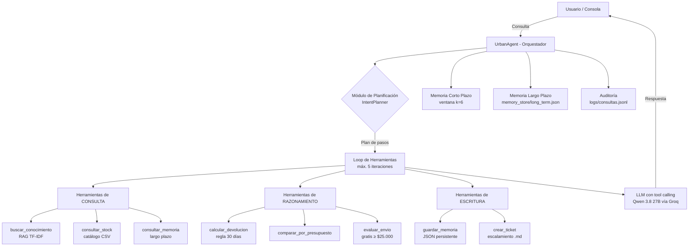

# UrbanStyle Agent — Agente Inteligente de Atención (Evaluación 3)

Agente funcional de atención al cliente para **UrbanStyle Chile** que integra herramientas de **consulta**, **razonamiento** y **escritura** sobre un framework de agentes (LangChain + Groq), con **memoria de corto y largo plazo**, **planificación adaptativa** y **auditoría** de cada interacción.

Continúa el chatbot RAG de la Evaluación 1, resollimitaciones detectadas: falta de memoria conversacional y ausencia de acciones de escritura/escalamiento.

## Arquitectura general



**Flujo de una consulta:**
1. El `IntentPlanner` clasifica la intención (devolución, stock, envío, producto, queja, general) y construye un plan de herramientas priorizadas, ajustándolo a condiciones cambiantes (fecha detectada, stock crítico, historial de la sesión).
2. El orquestador inyecta al LLM el system prompt, la memoria de largo plazo y el plan.
3. El LLM decide herramientas (tool calling) y el loop las ejecuta (máx. 5 iteraciones), realimentando los resultados.
4. Se actualiza la memoria de corto plazo, se persiste el resumen en largo plazo y queda registro de auditoría.

## Herramientas

| Tipo | Herramienta | Función |
|------|------------|---------|
| Consulta | `buscar_conocimiento` | RAG TF-IDF sobre catálogo, FAQ, políticas y guía de tallas |
| Consulta | `consultar_stock` | Precio, stock y tallas desde el catálogo CSV |
| Consulta | `consultar_memoria` | Recupera hechos del cliente (con búsqueda semántica TF-IDF) |
| Razonamiento | `calcular_devolucion` | Calcula plazo legal de 30 días desde la fecha de compra |
| Razonamiento | `comparar_por_presupuesto` | Alternativas por categoría y precio máximo |
| Razonamiento | `evaluar_envio` | Costo/plazo según monto, región y express |
| Escritura | `guardar_memoria` | Persiste hechos del cliente entre sesiones |
| Escritura | `crear_ticket` | Genera ticket de escalamiento `tickets/TCK-XXXX.md` |

## Memoria

- **Corto plazo** (`ShortTermMemory`): búfer de ventana k=6 turnos para coherencia dentro de la sesión.
- **Largo plazo** (`LongTermMemory`): hechos clave + resumen de interacciones en `memory_store/long_term.json`, sobrevive a reinicios; incluye **recuperación semántica** de hechos por TF-IDF.

## Instalación

```bash
git clone https://github.com/tu-usuario/urbanstyle-agent.git
cd urbanstyle-agent
python -m venv venv
venv\Scripts\activate         # Windows
pip install -r requirements.txt
cp .env.example .env          # agregar GROQ_API_KEY en .env
```

## Uso

```bash
python -m src.chatbot
```

Comandos útiles en la consola: `memoria` (ver hechos recordados), `salir`.

### Ejemplo de sesión (memoria entre conversaciones)

```
Sesión 1
Tú: Me llamo Camila, compré una chaqueta denim el 2026-10-01
UrbanAgent: [guardar_memoria] Listo Camila, registré tu compra.

Sesión 2 (reiniciando la aplicación)
Tú: ¿Todavía puedo devolver mi chaqueta?
UrbanAgent: [consultar_memoria] Según mi registro, compraste la Chaqueta Denim
el 2026-10-01. [calcular_devolucion] Dentro del plazo, quedan 12 días.
```

## Pruebas

```bash
pytest tests/ -v
```

Cubren herramientas (consulta/razonamiento/escritura), memoria persistente, planificación adaptativa y el loop del agente con LLM guionizado (sin necesidad de API).

## Estructura

```
urbanstyle-agent/
├── data/                      # Catálogo, FAQ, políticas, tallas
├── memory_store/              # Memoria de largo plazo (JSON)
├── logs/                      # Auditoría de consultas (JSONL)
├── tickets/                   # Tickets de escalamiento
├── src/
│   ├── agent.py               # Orquestador y loop de herramientas
│   ├── planning.py            # Planificador adaptativo
│   ├── memory.py              # Memoria corto/largo plazo
│   ├── tools.py               # Implementación de herramientas
│   ├── rag_pipeline.py        # Retriever TF-IDF
│   ├── load_documents.py      # Carga del corpus
│   ├── prompts.py             # Prompts del sistema
│   └── chatbot.py             # Interfaz de consola
├── tests/                     # Pruebas unitarias y de integración
└── requirements.txt
```

## Stack

| Componente | Tecnología | Justificación |
|-----------|-----------|---------------|
| Framework de agentes | LangChain (tool calling) | Continuidad con Eva 1; ecosistema maduro |
| LLM | Qwen 3.8 27B vía Groq | Continuidad con Eva 1; tool calling y latencia baja en plan gratuito |
| Recuperación | TF-IDF local (scikit-learn) | Sin costo, suficiente para corpus controlado |
| Memoria | JSON persistente + ventana k | Simple, auditable, sin infraestructura extra |

Proyecto académico — ISY0101 Ingeniería de Soluciones con IA, Duoc UC.
